<div align="center">

<picture>
  <source media="(prefers-color-scheme: dark)" srcset="assets/header-dark.svg">
  <source media="(prefers-color-scheme: light)" srcset="assets/header-light.svg">
  
</picture>

<br/>

<a href="https://www.linkedin.com/in/prajwalvernekar75"></a>&nbsp;<a href="mailto:prajwalvernekar75@gmail.com"></a>&nbsp;

</div>

---

### `> cat about.yaml`

```yaml
name:        Prajwal Vernekar
role:        Infrastructure Consultant @ Nutanix
location:    Pune, India
focus:
  - Nutanix AOS / AHV / NCC   # hyperconverged infrastructure
  - NKP & Kubernetes          # platform installs, GitOps with FluxCD
  - Server automation         # HPE iLO, Redfish, LLDP discovery
  - Tooling that's safe       # dry-runs, tests, clear exit codes
languages:   [Go, Python, Bash]
motto:       "automate the boring parts of infrastructure, then make them safe"
```

### `> ls ~/stack`

<p>
  
  
  
  
  
  
  
  <br/>
  
  
  
  
  
  
</p>

### `> ls ~/projects --featured`

<table>
<tr>
<td width="50%" valign="top">

**⚙️ [Nutanix-ncc-orchestrator](https://github.com/lTSPV75BRO/Nutanix-ncc-orchestrator)**<br/>
<sub>CLI that runs NCC health checks across many Nutanix clusters and aggregates the results.</sub><br/>


</td>
<td width="50%" valign="top">

**🛑 [prox-shutdown](https://github.com/lTSPV75BRO/prox-shutdown)**<br/>
<sub>Safe, ordered Proxmox VE shutdown that refuses during backups, migrations and DB dumps. Tested, ShellCheck-clean.</sub><br/>


</td>
</tr>
<tr>
<td width="50%" valign="top">

**☸️ [NKP_Scripts](https://github.com/lTSPV75BRO/NKP_Scripts)**<br/>
<sub>Production-ready installer/uninstaller for Nutanix NKP dependencies: Docker, kubectl and friends.</sub><br/>


</td>
<td width="50%" valign="top">

**🔌 [nutanix-lldp-report](https://github.com/lTSPV75BRO/nutanix-lldp-report)**<br/>
<sub>Collects LLDP switch neighbours and NIC status from Nutanix hosts into one report.</sub><br/>


</td>
</tr>
<tr>
<td width="50%" valign="top">

**🖥️ [HPE-iLO-automation](https://github.com/lTSPV75BRO/HPE-iLO-automation)**<br/>
<sub>HPE iLO Redfish scripts for BIOS settings and hardware inventory on Nutanix nodes.</sub><br/>


</td>
<td width="50%" valign="top">

**🔁 [NKP-CICD-Test](https://github.com/lTSPV75BRO/NKP-CICD-Test)**<br/>
<sub>GitOps CI/CD pipeline integrated with an NKP cluster using FluxCD.</sub><br/>


</td>
</tr>
</table>

### `> git log --graph --all`

<picture>
  <source media="(prefers-color-scheme: dark)" srcset="https://raw.githubusercontent.com/lTSPV75BRO/lTSPV75BRO/output/github-contribution-grid-snake-dark.svg">
  <source media="(prefers-color-scheme: light)" srcset="https://raw.githubusercontent.com/lTSPV75BRO/lTSPV75BRO/output/github-contribution-grid-snake.svg">
  
</picture>

<div align="center">
<sub><code>exit 0</code> · thanks for stopping by</sub>
</div>
